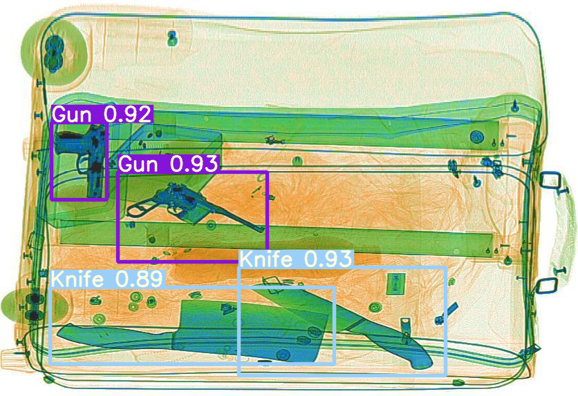
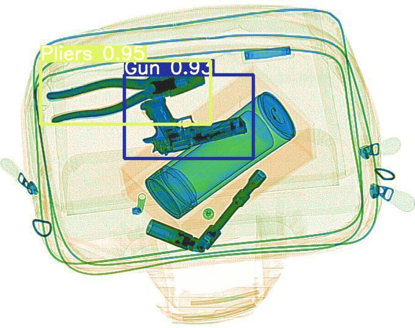
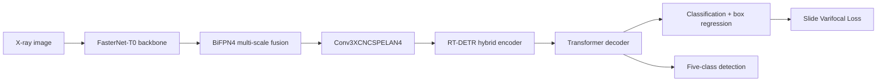

<div align="center">

# Lightweight RT-DETR for X-ray Contraband Detection

### End-to-end prohibited-item detection for security inspection

[](https://www.python.org/)
[](https://pytorch.org/)
[](https://docs.ultralytics.com/models/rtdetr/)
[](https://riverbankcomputing.com/software/pyqt/)

基于改进 RT-DETR 的轻量化 X 射线违禁品检测系统，支持图片、文件夹、视频和摄像头输入，覆盖训练、评估、可视化与本地/网页部署。




</div>

## 项目简介

面向机场、地铁等安检场景，识别枪支、刀具、扳手、钳子和剪刀五类违禁品。项目以 RT-DETR 为基线，通过轻量骨干、多尺度特征融合、重参数化模块和样本加权分类损失降低模型复杂度，同时保持检测精度，并提供 PyQt5 桌面端与 Streamlit Web 端交互界面。

## 核心指标

| Model | mAP@0.5 | mAP@0.5:0.95 | Params | FLOPs | FPS |
| --- | ---: | ---: | ---: | ---: | ---: |
| RT-DETR + ResNet-18 | 89.9% | 65.9% | 19.9M | 57G | 198 |
| **Improved RT-DETR** | **90.2%** | **66.1%** | **8.3M** | **20G** | **263** |
| 相对变化 | +0.3 pp | +0.2 pp | **-58.3%** | **-64.9%** | **+32.8%** |

> 测试条件：NVIDIA V100 16GB、640×640 输入、batch size 16、PyTorch 1.12.1 + CUDA 11.3。FPS 为批量推理吞吐，不等同于单张图片的端到端延迟。

## 模型改进



- **轻量骨干**：以 FasterNet-T0 替换 ResNet-18，降低参数和计算量。
- **多尺度融合**：将 CCFF 改进为 BiFPN4，增强跨尺度特征交互。
- **重参数化模块**：引入 Conv3XCNCSPELAN4，兼顾特征表达与推理效率。
- **困难样本加权**：使用 Slide Varifocal Loss 调整高、中、低质量样本的训练权重。
- **数据构造**：构建 5,000 张 SIXray-s 数据集，采用翻转、裁剪、对比度、高斯噪声和模糊/锐化等增强方式。

## 系统功能

| 功能 | 桌面端 | Web 端 |
| --- | :---: | :---: |
| 单张图片检测 | ✅ | ✅ |
| 文件夹批量检测 | ✅ | ✅ |
| 视频检测 | ✅ | ✅ |
| 摄像头检测 | ✅ | ✅ |
| YAML 模型配置 | ✅ | ✅ |
| 结果保存 | ✅ | ✅ |

桌面界面位于 [`run_gui.py`](run_gui.py)，网页版入口为 [`web_detection.py`](web_detection.py)，示例视频见 [`test.mp4`](test.mp4)。

## 快速开始

### 1. 安装依赖

```bash
git clone https://github.com/luo411422-hue/RT-DETR-Xray-Detection.git
cd RT-DETR-Xray-Detection
python -m venv .venv
pip install -r requirements.txt
```

训练环境建议使用 Python 3.9/3.10 与 CUDA 11.3，具体 PyTorch 版本需与本机 CUDA 驱动匹配。

### 2. 准备 SIXray-s 数据集

仓库包含数据构建脚本。准备 YOLO 格式的 SIXray 数据后运行：

```bash
python prepare_sixray_s.py \
  --source-root /path/to/SIXray \
  --output-root /path/to/SIXray-s \
  --overwrite
```

脚本默认从正样本中抽取 4,000 张图像，经过增强后生成 5,000 张、五类目标的 SIXray-s 数据集，并按 7:1:2 划分训练、验证和测试集。

### 3. 训练与评估

修改 [`experiment.yaml`](experiment.yaml) 中的模型路径、数据路径和设备编号：

```yaml
model: /path/to/rtdetr-fasternet.yaml
data: /path/to/SIXray-s/data.yaml
device: 0
```

运行完整训练、验证、FPS 和模型复杂度评测：

```bash
python experiment.py experiment.yaml
```

### 4. 启动检测系统

先修改 [`rtdetr.yaml`](rtdetr.yaml) 中的训练权重路径，然后启动桌面端：

```bash
python run_gui.py
```

或启动 Web 端：

```bash
streamlit run web_detection.py
```

## 仓库结构

```text
.
├── experiment.py              # 训练、验证、FPS 与复杂度评测
├── experiment.yaml            # 训练配置
├── prepare_sixray_s.py        # SIXray-s 数据构造与增强
├── rtdetr.yaml                # 推理模型配置
├── run_gui.py                 # PyQt5 桌面端
├── web_detection.py           # Streamlit Web 端
├── yolo.py                    # YOLO / RT-DETR 推理封装
├── ultralytics/               # 自定义 RT-DETR 与网络组件
├── Annotation/                # 示例标注
├── images/                    # 输入示例
└── result/                    # 检测结果示例
```

## 技术栈

`Python` · `PyTorch` · `RT-DETR` · `FasterNet` · `BiFPN` · `OpenCV` · `PyQt5` · `Streamlit` · `CUDA`

## 复现说明

- 仓库不包含训练权重和完整数据集，需要按 `prepare_sixray_s.py` 重新生成数据并训练。
- 核心指标来自项目报告；复现时应在固定数据划分、推理尺寸和硬件条件下重新评测。
- `FPS` 受 GPU、batch size、TensorRT/框架版本影响，不能与其他硬件上的单帧延迟直接比较。
- 当前项目完成的是本地与网页系统部署，尚未将模型转换为 TensorRT、ONNX Runtime 或 RKNN 边缘推理格式。

